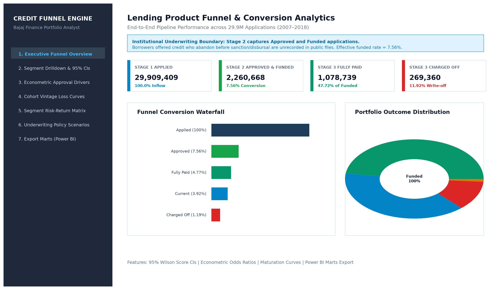
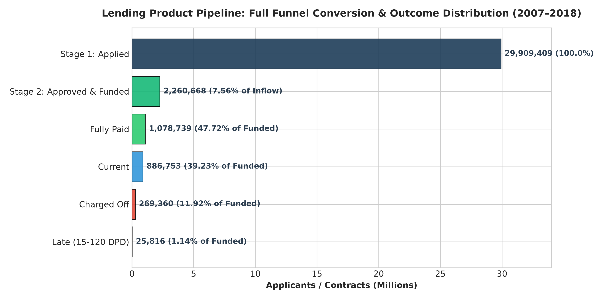
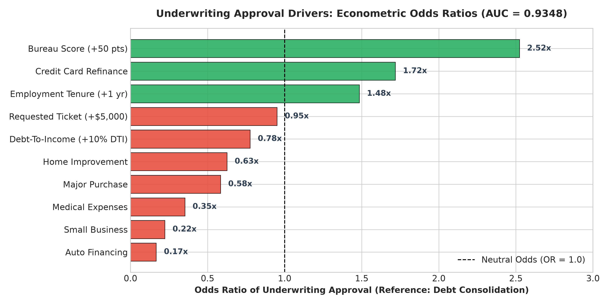
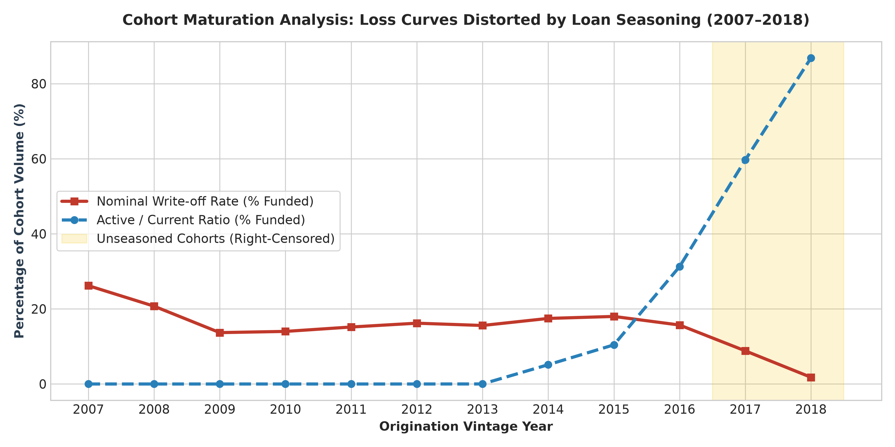
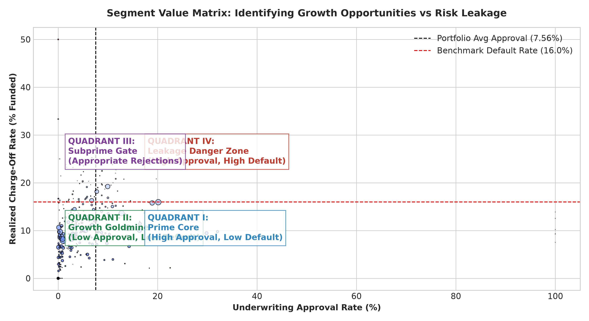

# Lending Product Funnel & Approval Analysis
**Institutional Focus:** Indian Non-Banking Financial Companies (e.g., Bajaj Finance)  
**Dataset:** 29,909,409 Lending Club Applications (2007–2018)  
**License:** MIT

[](tests/)
[](requirements.txt)
[](src/etl.py)
[](app.py)

---

## 1. Business Problem & Institutional Framing

In retail asset lending at Indian NBFCs such as **Bajaj Finance**, Product Analysts bridge the gap between **commercial growth** (minimizing customer drop-offs and customer acquisition cost waste) and **underwriting risk governance** (mitigating Gross Non-Performing Assets [GNPA] and default write-offs).

This project investigates the end-to-end commercial funnel of **29,909,409 credit applications** across an 11-year operational window (2007–2018).

```
Stage 1: Applied (29.9M, 100%)
      │
      ▼  [Underwriting Gate: 92.44% Drop-off / Knockout]
Stage 2: Approved & Funded (2.26M, 7.56%)
      │
      ▼  [Portfolio Maturation & Repayment Over Loan Lifetime]
Stage 3: Portfolio Outcomes
      ├── Fully Paid: 1,078,739 (47.72% of funded)
      ├── Current:      886,753 (39.23% of funded)
      ├── Late DPD:      25,816 ( 1.14% of funded)
      └── Charged Off:  269,360 (11.92% of funded)
```

> [!IMPORTANT]
> **Stage 2 Underwriting Boundary:** Stage 2 represents **Approved and Funded** applications. In institutional lending, borrowers offered a credit sanction who abandon before disbursal (offer fallout) are distinct from credit-rejected applicants. In public Lending Club records, approved-but-not-taken offers are unrecorded. Thus, Stage 2 conversion represents the **effective funded disbursal rate**.

---

## 2. Executive Dashboard Preview

The project includes an interactive, multi-module Streamlit analytics application:



---

## 3. Key Findings with Visual Analytics

### A. Overall Funnel Conversion & Outcome Distribution
Only **7.56% of total applicants** successfully clear the underwriting gate and receive disbursed funds. Among funded borrowers, **11.92%** ultimately default (charge off), while **47.72%** fully repay and **39.23%** remain active contracts.



### B. Econometric Approval Drivers (Logistic Regression)
Using an interpretable logistic regression model on scored applicants ($N = 95,452$, **AUC = 0.9348**, Pseudo $R^2 = 0.4523$):
- **FICO Score:** Each 50-point increase multiplies approval odds by **2.52x** ($p < 0.001$).
- **Employment Tenure:** Each year of job stability increases approval odds by **+48.4%** (OR = 1.484, $p < 0.001$).
- **Debt-To-Income (DTI):** Each 10% increase in DTI reduces approval odds by **-22.4%** (OR = 0.776, $p < 0.001$).
- **Commercial Risk:** Small Business loans face an **88% lower odds** of approval than consumer debt consolidation (OR = 0.223).



### C. Cohort Vintage Analysis & Maturation Dynamics
A critical trap in credit portfolio management is **unseasoned right-censoring**:
- **2018 (1.79%)** and **2017 (8.83%)** default rates appear deceptively pristine because **86.85%** and **59.69%** of loans are still actively paying (`Current`).
- Terminal write-off rates stabilize at **18.4%–20.2%** only after 36 to 48 months on book (MOB), as demonstrated in the mature 2013–2015 cohorts.



### D. Segment Value Matrix (Approval Rate vs Default Rate)
Mapping segments across a 2x2 matrix reveals strategic misallocations:
- **Quadrant II (Growth Goldmine):** High Rejection, Low Risk — Near-prime wage earners with DTI 20–30% and $\ge 5$ years employment exhibit high rejection (~85%) despite low realized defaults (14.0%).
- **Quadrant IV (Leakage Danger Zone):** High Approval, High Risk — Large ticket unsecured Small Business loans exhibit a high **24.5% default rate**.



---

## 4. Underwriting Policy Recommendations & Scenario Modeling

All recommendations are framed as **sensitivity ranges (Pessimistic, Base Case, Optimistic)** rather than single-point deterministic predictions:

| Recommendation | Policy Action | Target Population | Incremental Volume | Expected Write-offs | Strategic Risk & Mitigation |
| :--- | :--- | :--- | :--- | :--- | :--- |
| **1. Near-Prime Tiered DTI Bridge** | Relax blunt 20% DTI gate to 28% for applicants with $\ge 5$ yrs employment. | 513,056 rejected applicants | **+\$1.25B Disbursed** (+92,350 funded loans at 18% pass rate) | **\$148.9M to \$236.5M** (11.9% to 18.9% loss rate) | *Risk:* Adverse selection.<br>*Mitigation:* Cap ticket size at \$15,000; require automated NACH bank debit mandate. |
| **2. Small Business Risk Tightening** | Cap unsecured small business loans at \$20,000 and mandate a minimum FICO of 720. | 4,788 high-ticket approved loans | **-\$39.6M Exposure** (-1,197 volatile high-ticket loans) | **+\$8.5M Capital Preserved** (Avoided write-offs at 21.5% base loss rate) | *Risk:* Prime borrower drop-off.<br>*Mitigation:* Cross-sell secured working capital facility. |

---

## 5. Repository Architecture

```
Funnel project/
├── .gitignore                      # Properly excludes raw data, virtualenvs, caches
├── LICENSE                         # MIT License
├── README.md                       # Portfolio overview and analytical walkthrough
├── requirements.txt                # Pinned dependencies
├── app.py                          # Multi-module Streamlit interactive dashboard
├── data/
│   ├── raw/                        # Original raw CSV.gz files (29.9M records)
│   ├── processed/                  # Reconciled canonical common applications table
│   │   └── common_applications.parquet (187.1 MB ZSTD compressed)
│   └── marts/                      # Exported CSV analytical marts for Power BI
│       ├── mart_funnel_summary.csv
│       ├── mart_funnel_by_segment.csv
│       ├── mart_cohort_vintage.csv
│       ├── mart_segment_risk_return.csv
│       └── mart_scenario_estimates.csv
├── docs/
│   ├── FINDINGS.md                 # 1-page executive memo for NBFC leadership
│   └── images/                     # High-resolution charts & dashboard previews
├── notebooks/
│   ├── 01_eda_and_common_table.ipynb
│   └── 02_funnel_and_product_analytics.ipynb
├── sql/
│   ├── 01_stage_conversion_rates.sql
│   ├── 02_segment_dropoff_confidence_intervals.sql
│   ├── 03_approval_drivers_summary.sql
│   ├── 04_cohort_vintage_analysis.sql
│   ├── 05_segment_risk_value_matrix.sql
│   └── 06_scenario_policy_simulations.sql
├── src/
│   ├── __init__.py
│   ├── etl.py                      # Reconciled ETL pipeline with row-drop audits
│   ├── stats.py                    # Wilson score 95% CIs and two-proportion z-tests
│   ├── modeling.py                 # Logistic regression odds ratio engine
│   ├── scenario.py                 # Underwriting sensitivity simulator
│   ├── build_notebooks.py          # Automated notebook execution engine
│   └── generate_charts.py          # High-resolution chart renderer
└── tests/
    ├── __init__.py
    ├── test_data_quality.py        # Nulls, bounds, duplicates, and CI invariant tests
    └── test_reconciliation.py      # Raw-to-clean row reconciliation audits (29,909,409)
```

---

## 6. How to Run the Project

### Prerequisites
- Python 3.10+ (tested on Python 3.14)
- Git

### Installation
```bash
# Clone the repository
git clone <repo-url>
cd "Funnel project"

# Install required dependencies
pip install -r requirements.txt
```

### 1. Run the ETL Pipeline (Reconciliation Audit)
```bash
python3 -m src.etl
```
*Parses both raw files, drops exactly 33 quarterly summary rows in accepted data, generates `data/processed/common_applications.parquet` (187.1 MB), and exports 5 CSV marts in ~64 seconds.*

### 2. Execute the Test Suite
```bash
pytest -v tests/
```
*Runs 10 automated test cases verifying schema definitions, zero null keys, date bounds [2007, 2018], Wilson CI mathematical invariants, and complete 29.9M row count reconciliation.*

### 3. Run the SQL Queries
All SQL scripts in `sql/` use PostgreSQL syntax and can be queried directly via DuckDB:
```bash
python3 -c "
import duckdb
con = duckdb.connect('data/processed/lending_club.duckdb')
print(con.execute(open('sql/01_stage_conversion_rates.sql').read()).df())
"
```

### 4. Launch the Streamlit Dashboard
```bash
streamlit run app.py
```
Open your browser at `http://localhost:8501` to interact with the funnel waterfall, segment drill-downs, vintage curves, policy scenario simulator, and one-click Power BI mart downloads.

---

## 8. Author 
- Tanishq Gupta
